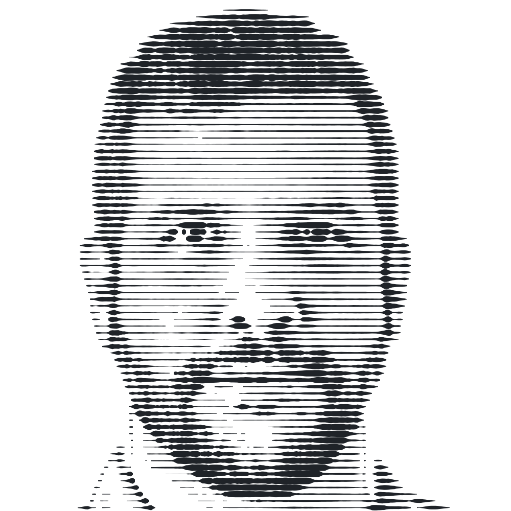

<picture>
  <source media="(prefers-color-scheme: dark)" srcset="assets/portrait-dark.svg">
  
</picture>

### Humberto Salazar

I build cloud-scale systems at AWS, and small machines at home that make my own work easier.

- **[Deck for T3 Code](https://github.com/hsalazr/deck-for-t3code)**: a Stream Deck plugin that puts AI coding agents on keys. [Website and demo](https://hsalazr.github.io/deck-for-t3code/).
- **TilePane**: a Raspberry Pi touchscreen dashboard in a 3D-printed case. The open-source edition is in progress.

More about me and what I build: **[hsalazar.xyz](https://www.hsalazar.xyz/)** · [LinkedIn](https://www.linkedin.com/in/hsalazarpacios) · [X](https://x.com/hsalazar) · [contact@hsalazar.xyz](mailto:contact@hsalazar.xyz)

If something I made saves you time, you can [sponsor my open-source work](https://github.com/sponsors/hsalazr).

Views here are my own.
